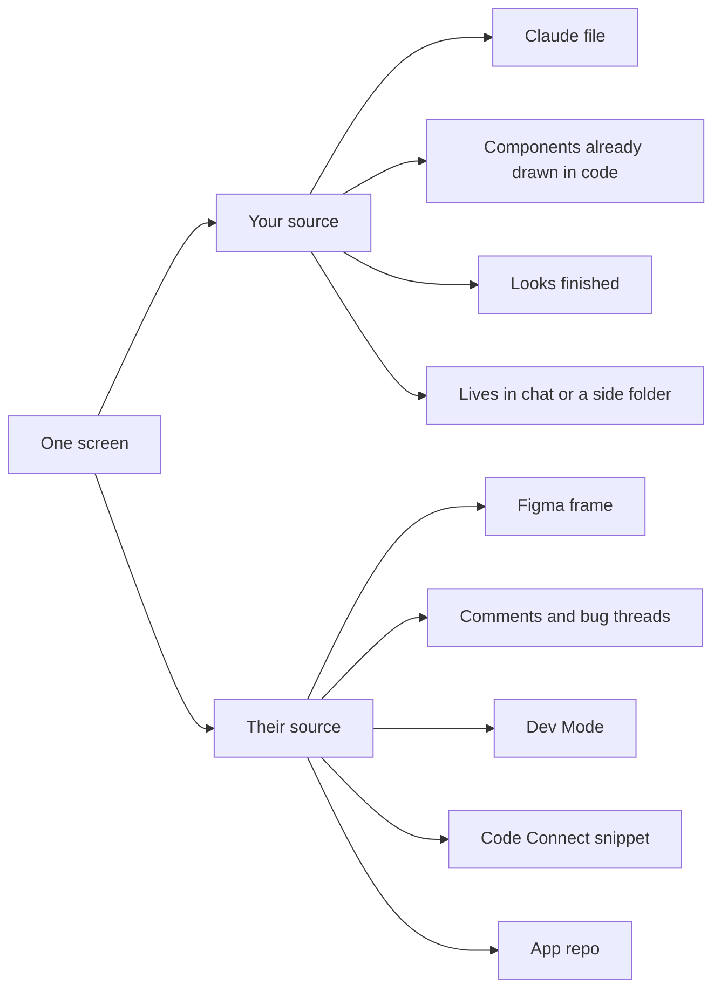
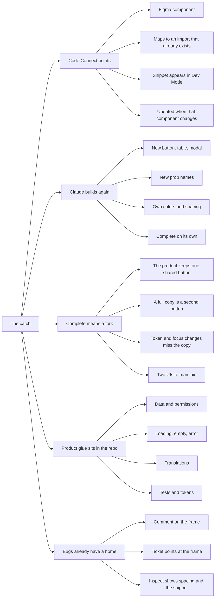
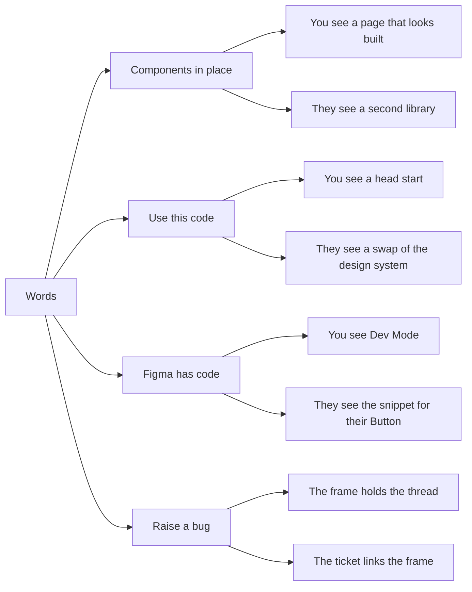
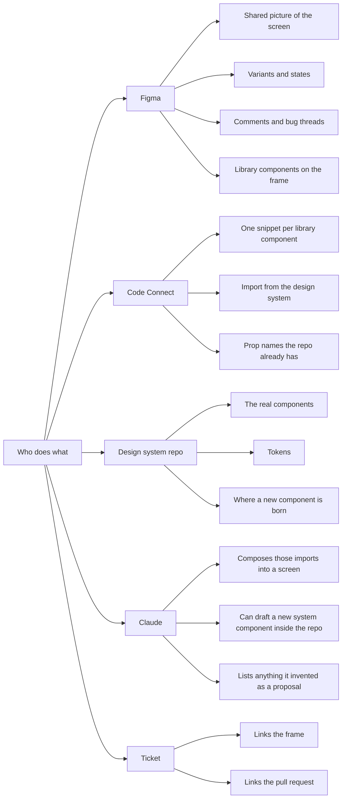
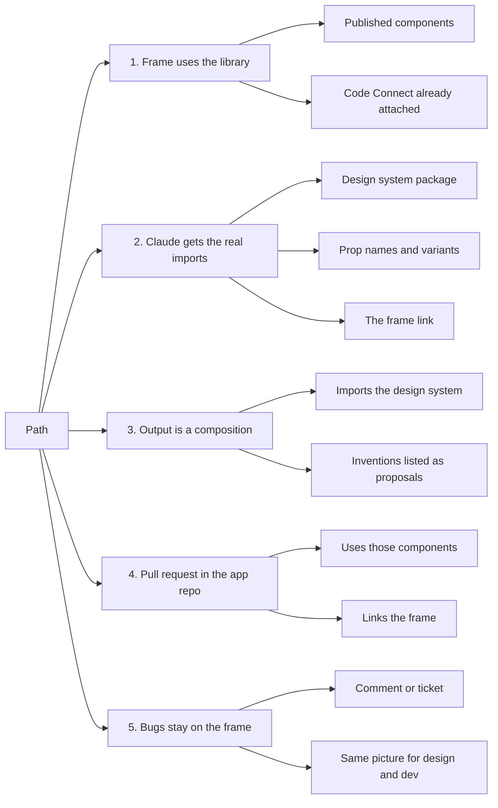
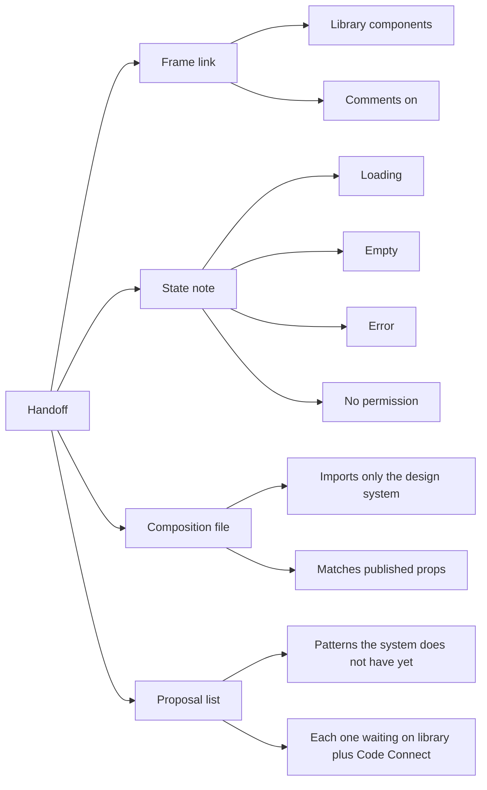
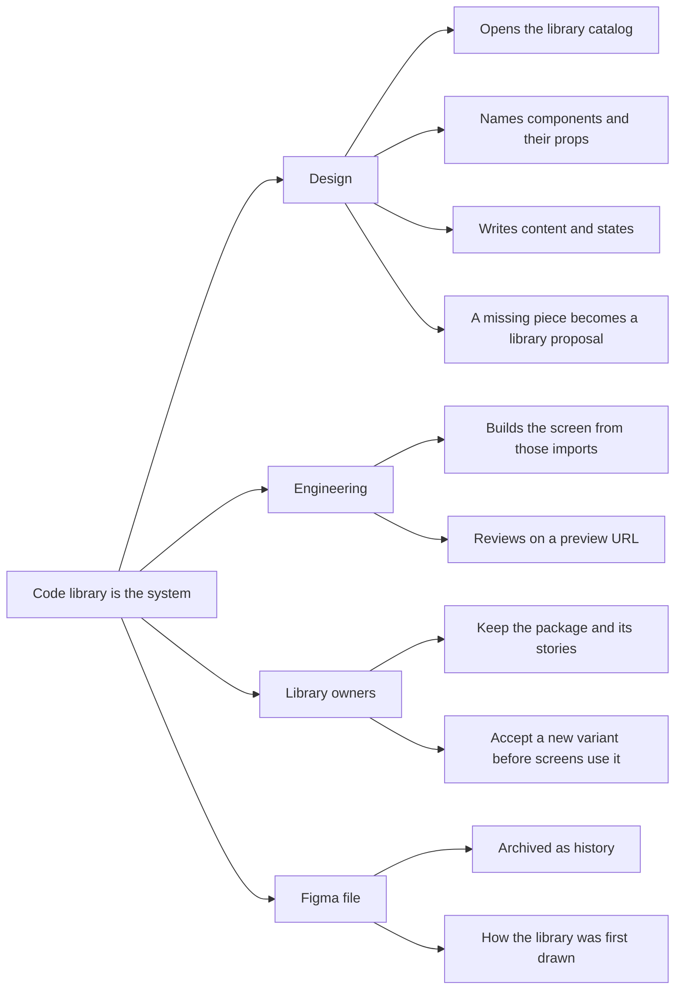
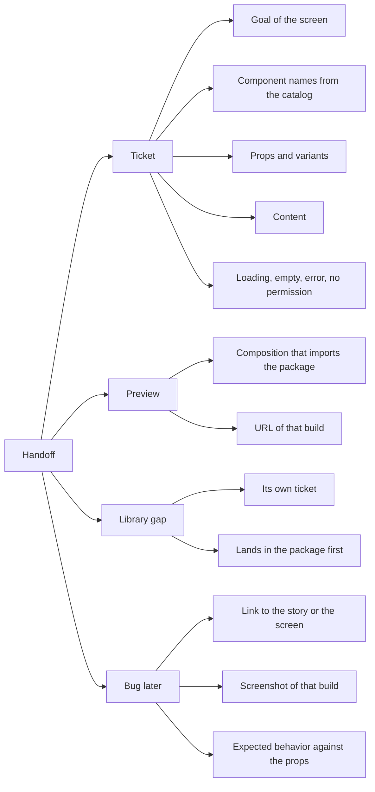
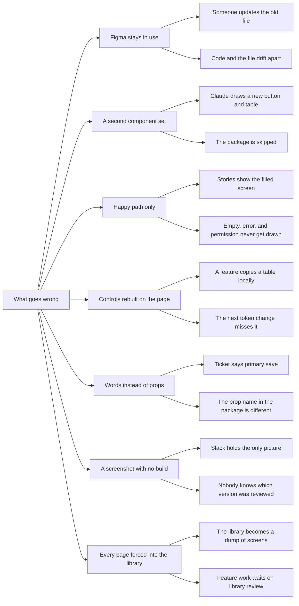
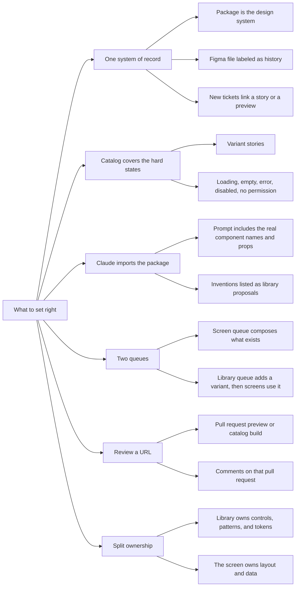

# Why your Claude file never shows up in their Figma

Code Connect was set up so Dev Mode shows the **real component** from the app. The file from Claude is a **second build** of the same screen. Developers collaborate on the frame. They ship from the repo. The chat file is a third place, so it stays unused.

Read the maps in order. The caption under each one is the talk-through.

Maps 1–6 are the loop while Figma is still the shared room. Maps 7–10 are the loop after the code library has replaced it. The library already exists. It was built from the Figma design system. Figma is the piece leaving.

---

## 1. Same screen, two sources

You are looking at a finished file. They are looking at the frame. Dev Mode is where they answer “which of our components is this?” The snippet there is written to match the design system in the repo. Your file never enters that panel, so it is invisible in the place they already work.

---

## 2. The catch

Code Connect is a **pointer**. A published Figma component is tied to a snippet such as `import { Button } from "@company/design-system"`. When someone selects that button in Dev Mode, they see that snippet. The mapping lives with the design system. It updates when the real component changes.

The Claude file **builds the screen again**. “Components in place” means the page can run by itself: its own button, its own table, its own spacing. That self-contained file is a fork. The product is trying to keep a single button so a token change, a focus ring, or a loading state happens once. A second button in a side file misses that change, and someone would have to maintain both.

The rest of an enterprise screen is glue that lives in the repo: data, permissions, empty and error states, translations, tests. Developers rebuild that glue from the library, so a visually finished file still gets rewritten.

Bugs already have a home on the frame. A comment or a ticket can point at the same picture the whole team sees. The chat transcript is not that record.

---

## 3. What the words mean

The mismatch is vocabulary. A file that looks done reads, on their side, as a request to swap the design system. Dev Mode “having code” means the official snippet, the one Code Connect was added to show. Bug threads stay on the frame because that is the shared picture.

---

## 4. Split the jobs

Figma holds the picture and the conversation. Code Connect holds the sentence “use this import.” The design system repo holds the actual components. Claude’s useful job is to **compose those imports**, or to draft a new system component **inside that repo**. A component invented only in chat stays a proposal until it exists in the library and in the design system, with a Code Connect snippet of its own.

---

## 5. How a screen gets through

The frame is built from the published library, so Dev Mode already shows the right snippets. Claude is given that package, those prop names, and the frame link, and it writes a composition that imports them. Anything it had to invent is labeled a proposal, which waits for a library component and a design-system addition before a screen depends on it. The pull request lives in the app repo and links the frame. Later bugs go on that frame, so design and engineering stay on one picture.

---

## 6. What you send

Send the frame, a short note for the states the frame does not draw, a composition that imports the design system, and a list of proposals. A proposal is a pattern the system does not have yet. It becomes usable after it is added to the Figma library, built in the design system repo, and given a Code Connect snippet.

---

## 7. Where the team works

The design system now lives in the component package the dev team already built. The catalog of that package — Storybook, if the package is published that way, or the component docs in the repo — is the picture everyone opens. Design reads it and names real components and real props. Engineering builds the screen from those imports and reviews a preview of that build. Library owners keep the package. A new variant is accepted there before a screen depends on it.

The Figma file stays as history of how those components were first drawn. New screens start in the catalog.

---

## 8. How a handoff moves

A handoff is a ticket plus a preview. The ticket names the goal, the components as they are called in the catalog, the props and variants, the content, and the states. The preview is a composition that imports the package, at a URL people can open. Comments happen on that pull request.

Anything the library cannot do yet is a separate library ticket. The screen starts using it after that change is in the package.

A later bug points at the story or the screen, includes a screenshot of that build, and says what the props should have done.

---

## 9. What goes wrong

The old file is the easiest thing to reopen. One edit there and the team has two design systems again.

With no frame to attach to, a Claude page that “has the components” is the same fork as before. It brings its own button and table and never imports the package.

Stories that only show the filled screen hide loading, empty, error, and permission. The handoff looks finished and the screen breaks on real data.

A feature that copies a table into the page has left the library. The next token or focus change does not reach it.

A ticket written in loose words (“primary save”) and a package that names that idea differently will be implemented twice, two different ways.

A screenshot in chat has no version. Review comments stick to a picture nobody can reopen.

Putting every full page into the library clogs it. Feature work then waits on a library review it did not need.

---

## 10. What to set right

Name the package as the design system, and label the Figma file as history. New tickets link a story or a preview.

Give each component stories for its variants and for the hard states, so the catalog shows what the screen will actually do.

Give Claude the real names and props from the catalog. A composition may import the package. Anything it invents is a library proposal, and it waits.

Keep two queues. A screen is composed from components that already exist. A missing variant is a library change, merged first, then used by the screen.

Review happens on a preview URL, and the comments stay on that pull request.

The library owns the controls, the shared patterns, and the tokens. The screen owns layout and data. A new page does not become a new component, and a screen does not carry its own copy of a button.
